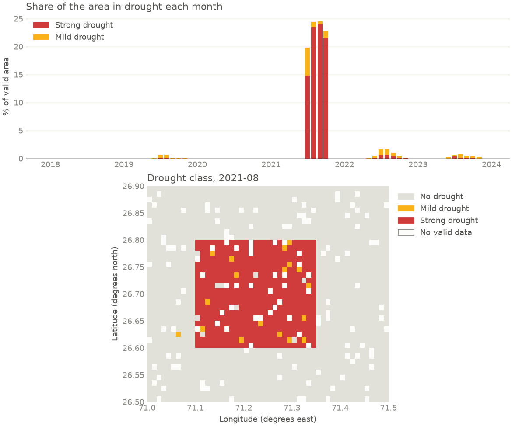

# Remote Sensing Based Drought Classification

This project started with a simple question: can you look at a satellite vegetation image and tell whether an area is in drought?

The first version was a joint project: Sentinel-2 NDVI imagery pulled from Copernicus, an SVM that sorts images into no, mild and strong drought, and a small Streamlit app on top of it. Later I added a terminal pipeline that works from the actual red and near-infrared bands, because that's a more defensible way to measure drought than looking at coloured pictures.

So there are really two things in this repo, and they do different jobs.

| | SVM app | Terminal pipeline |
|---|---|---|
| **Input** | A rendered NDVI image | A NetCDF cube of red and NIR reflectance |
| **Method** | SVM on flattened pixels | Monthly composites and anomalies against each pixel's own history |
| **Output** | One label for the image | A label per pixel per month, plus maps, a time series and a report |
| **Tested on** | 39 real images | Synthetic data with a known answer |



That figure comes from the demo below. The data is synthetic: I planted a drought in a box from July to October 2021, and the pipeline had to find it without being told where it was.

## Try it

You'll need Python 3.12. No accounts, API keys or downloads beyond the packages.

```bash
pip install -r requirements.txt
python -m drought demo --outdir out
python -m pytest
```

Or with Docker, which runs the tests and then the demo:

```bash
docker build -t drought .
docker run --rm drought
```

## The terminal pipeline

```bash
python -m drought synth out/scene.nc
python -m drought run out/scene.nc --outdir out --map-month 2021-08
```

`run` works on any NetCDF file with `red` and `nir` bands over `time`, `lat` and `lon`. It goes through these steps:

1. **Check the input.** It looks at the CRS, coordinate ranges, grid spacing, timestamp order, units, reflectance range and how much data is missing. If something is badly wrong, like raw digital numbers instead of reflectance, it stops and exits with code 2 instead of producing nice-looking nonsense.
2. **Clean up.** Values outside 0 to 1 get masked, and cloud gaps stay as gaps. Nothing gets filled in.
3. **Build monthly composites.** NDVI and SAVI take the highest value per pixel per month, since cloud and haze pull NDVI down.
4. **Work out the anomaly.** Each month is compared with the same calendar month in other years, using the median and MAD so the drought years don't drag the baseline towards themselves.
5. **Classify.** Mild is an anomaly of -2 or lower, strong is -3 or lower, and a pixel needs two low months in a row before it counts.

You get these files:

| File | What's in it |
|---|---|
| `drought_indices.nc` | NDVI, SAVI, anomaly, VCI and drought class, with CF-style metadata |
| `regional_timeseries.csv` | Area-weighted NDVI and drought share per month, using cos(latitude) weights |
| `drought_class.tif` | Class map for one month as a GeoTIFF in EPSG:4326 |
| `overview.png` | The figure above |
| `report.json` | Input hash, parameters, package versions, every check result and output fingerprints |

### How well does it work?

On the synthetic cube with seed 42:

| Method | Precision | Recall | False alarm rate |
|---|---|---|---|
| Anomaly classes (what I use) | 0.90 | 0.91 | 0.13% |
| VCI below 20 | 0.05 | 1.00 | 25% |

Across four seeds the anomaly method stays in the range of 0.79 to 0.90 precision and 0.91 to 0.96 recall.

VCI (the Vegetation Condition Index) looks like the obvious choice, and the pipeline still writes it out, but it behaves badly on a short record. VCI scales each pixel between its lowest and highest value for that month. With six years of data, some year has to be the lowest, so it scores 0 whether there was a drought or not. That's where the 25% comes from.

Please don't read too much into these numbers. The thresholds were chosen on the same synthetic data the generator produces, so all this shows is that the code does what it should on a problem with a known answer. It says nothing about how well those thresholds suit real crops in real seasons.

## The Streamlit app

```bash
streamlit run app.py
```

You can upload an NDVI image, or enter coordinates and a date range to fetch one from Copernicus. Fetching needs your own Copernicus credentials, set as environment variables. Uploading doesn't.

```bash
export COPERNICUS_CLIENT_ID=your-id
export COPERNICUS_CLIENT_SECRET=your-secret
```

The trained model is too big for Git, so the app downloads it from Google Drive the first time it runs (see [LARGE_FILES.md](LARGE_FILES.md)). Loading a pickle can run code, so only use a model file you trust. If you set `MODEL_SHA256` to the file's hash, the app refuses to load anything else.

### Model results

The final model is an SVM (RBF kernel, C=10) on 512 x 512 RGB images. It scored 92.3% accuracy on the test set, with weighted F1 at 0.92.

That number needs some context. There are only 193 images in total, so the test set is 39 images and 92.3% means 3 wrong. The split is also random, so images from neighbouring dates can end up on both sides, which probably flatters the score.

## A small benchmark task

`benchmark_task/` is a self-contained exercise you could hand to a person or a terminal agent. The input looks like it came out of an old processing chain: reflectance stored as scaled integers, a custom missing-data flag, shuffled months and a north-to-south grid. The job is to produce a correct area-weighted SAVI time series.

```bash
python benchmark_task/make_data.py task
python benchmark_task/solution/solve.py task/scene.nc task/results.csv
python benchmark_task/tests/grade.py task/results.csv task/truth.json
```

The grader compares results to the answers within a tolerance of 0.001. The answers come straight from the generator, not from the `drought` package. A benchmark is only useful if lazy answers fail, so the tests check that skipping the scaling, the masking, the weighting or the sorting each gets a failing grade, and that the reference solution passes.

## Tests

`python -m pytest` runs 86 tests in about a minute, with no network or credentials:

- Index and anomaly maths against values worked out by hand
- Bad input being rejected: wrong CRS, unsorted or duplicate timestamps, uneven grids, wrong units, raw digital numbers
- The planted drought coming back in the right place and months
- File formats and metadata, including reading the GeoTIFF back by coordinate to catch a flipped raster
- The same input giving the same output
- The Streamlit app itself, driven with a small stand-in model, including malicious text in the coordinates box
- The download scripts running against a fake API

CI runs the tests, the demo and the Docker image on every push.

## What's in the repo

```
app.py                     Streamlit app
SVM_Model.py               Trains the final SVM and saves it
RS_Drought_M.ipynb         Original experiments and grid search
copernicus_*_download.py   Pull NDVI and SAVI imagery from Copernicus
evalscripts                Sentinel Hub scripts for NDVI, SAVI and MSI
drought/                   The terminal pipeline
benchmark_task/            The benchmark exercise
tests/                     Test suite
```
